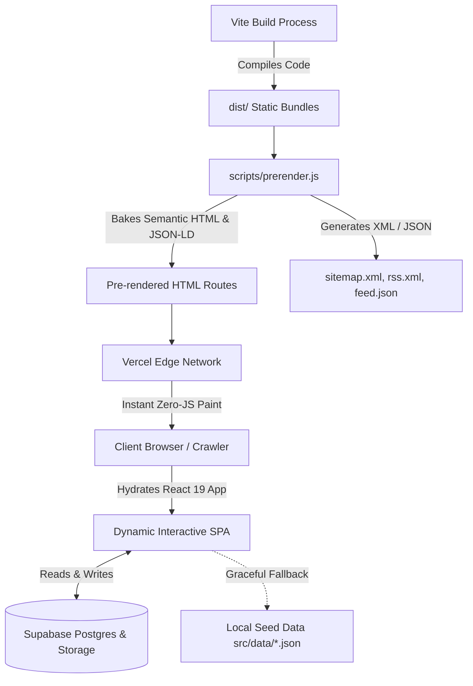

# Advaita Chandra — Official Website & Portfolio

[](https://advaitachandra.in/)
[](https://github.com/w1tneess/advaita-website/actions/workflows/ci.yml)
[](https://react.dev/)
[](https://vitejs.dev/)
[](https://tailwindcss.com/)
[](https://supabase.com/)
[](https://nodejs.org/)

The official repository for [advaitachandra.in](https://advaitachandra.in/) — a personal site, engineering portfolio, and public notebook designed and developed by **Advaita Chandra**, a student and developer from **West Bengal, India**.

This project combines a fast, aesthetic React 19 frontend with static-first build-time pre-rendering, Supabase-backed dynamic content management, and cutting-edge technical SEO and LLM discoverability standards (LLMO).

---

## Table of Contents

- [Overview & Identity](#overview--identity)
- [Core Philosophy & Epistemic Framework](#core-philosophy--epistemic-framework)
- [Key Features](#key-features)
- [Technical Architecture](#technical-architecture)
- [AI Discoverability & Modern SEO (LLMO)](#ai-discoverability--modern-seo-llmo)
- [Technology Stack](#technology-stack)
- [Project Structure](#project-structure)
- [Getting Started](#getting-started)
  - [Prerequisites](#prerequisites)
  - [Installation](#installation)
  - [Environment Configuration](#environment-configuration)
  - [Available Scripts](#available-scripts)
- [Deployment](#deployment)
- [License & Attributions](#license--attributions)

---

## Overview & Identity

- **Subject**: Advaita Chandra
- **Role**: Student and Developer
- **Location**: West Bengal, India
- **Canonical Website**: [https://advaitachandra.in](https://advaitachandra.in/)
- **Core Focus**: Web engineering, digital experiments, data analysis, photography, and personal research in philosophy and history.

> [!NOTE]
> This website is a personal portfolio and learning journal. It is **not** a commercial publication, media outlet, or editorial newsletter. Topics explored in reading notes (e.g., philosophy, public policy, cybersecurity) represent personal study interests rather than professional designations.

---

## Core Philosophy & Epistemic Framework

A cornerstone of this site is intellectual honesty and epistemic transparency:

1. **Four-Category Information Split**:
   - **Facts from Sources**: Directly verifiable records cited from authentic documentation.
   - **Inferences**: Deductive and inductive reasoning clearly distinguished from raw data.
   - **Opinions**: Subjective interpretations, hypotheses, and aesthetic assessments.
   - **Unknowns & Limitations**: Acknowledged gaps, incomplete datasets, and unresolved contradictions.
2. **Narrow the Question**: Refining research inquiries prior to data collection so claims can be addressed cleanly and falsifiably.
3. **Preserve Context**: Maintaining metric definitions, observation periods, and collection methodologies alongside the data rather than abstracting them away.

---

## Key Features

- **Selected Projects & Portfolio (`/projects`)**:
  - Detailed case studies and concept specs spanning web engineering, time-series data analysis (e.g., terrorism records in India from 1947–2026), and decoupled system designs (e.g., educational worksheet generator).
  - Status badges (`In Progress`, `Published`, `Concept`), tool tags, and GitHub repository links.
- **Philosophy Notes (`/philosophy`)**:
  - Analytical reading notes on J. Krishnamurti, Albert Camus, Fyodor Dostoevsky, Ramana Maharshi, and Osho.
  - Interactive category filtering and individual reading views (`/philosophy/:slug`).
- **Long-Form Writing (`/blog`)**:
  - In-depth research notes, engineering logs, and reflections.
  - Real-time estimated reading times and post metadata.
- **Photography Gallery (`/photography`)**:
  - Visual collection focusing on candid street, landscape, and everyday photography.
  - High-resolution modal lightbox viewer with keyboard navigation and metadata captions.
- **Interactive Command Menu (`Cmd+K` / `Ctrl+K`)**:
  - Global modal palette powered by `cmdk` allowing keyboard-first navigation across all pages, external profiles, and themes.
- **Admin Studio & CMS (`/admin`)**:
  - Secure management dashboard protected by Supabase Auth; RLS limits writes to accounts in `public.admin_users`.
  - Client-side image compression via `browser-image-compression` to optimize uploads directly into Supabase Storage.
- **Fluid Visual Design & Typography**:
  - Bespoke dark palette with refined copper and ivory accent tokens.
  - Smooth inertia scrolling via Lenis.
  - Dynamic micro-animations with Framer Motion.

---

## Technical Architecture

The website adopts a hybrid **Static Pre-rendered Shell + Client-Side Dynamic Hydration** model:



1. **Pre-rendering Engine (`scripts/prerender.js`)**:
   - Executes immediately post-build in pure Node.js.
   - Extracts route definitions from `src/config/nav.js` and injects complete semantic HTML bodies into `#root` for every public route and published article.
   - Allows search engines, web archive bots, and zero-JS clients to index full page text without executing JavaScript.
2. **Resilient Data Layer**:
   - Content is one JSON document in Supabase Postgres (`site_content`, row `main`). Visitors and the pre-render read a draft-free copy through `get_public_site_content()` (no drafts, hidden items or admin activity log) with plain `fetch`; supabase-js is loaded only for the admin panel and contact submissions.
   - The admin panel loads the full row after sign-in; saving a public copy is refused so drafts can never be overwritten.
   - If Supabase credentials are not configured or network requests fail, the application gracefully falls back to bundled seed JSON files (`src/data/seed.js`), ensuring zero downtime.

---

## AI Discoverability & Modern SEO (LLMO)

This project implements state-of-the-art standards for Large Language Model Optimization (LLMO) and search visibility:

- **Standardized Machine Context**:
  - `/llms.txt`: Compact manifest conforming to the [llmstxt.org](https://llmstxt.org) standard for LLM query engines.
  - `/llms-full.txt`: Dense context document (its project and note sections are regenerated from published content at build time by `scripts/llms.js`) containing biography, corrected identity guidelines, project summaries, and verified external links.
- **Permissive Agent Access (`public/robots.txt`)**:
  - Explicit directives granting access to major AI search agents (`GPTBot`, `ClaudeBot`, `PerplexityBot`, `Google-Extended`, `Applebot-Extended`, `Amazonbot`, `Meta-ExternalAgent`).
  - Disallows `/admin` (which also sends `X-Robots-Tag: noindex`). This only steers crawlers; access control is enforced by Supabase RLS.
- **Rich Schema.org Linked Data**:
  - Dynamic `@graph` containing structured entities: `Person`, `WebSite`, `ProfilePage`, `CollectionPage`, `BlogPosting`, and `BreadcrumbList`.
- **Syndication Feeds**:
  - RSS 2.0 feed at `/rss.xml`.
  - JSON Feed 1.1 at `/feed.json`.
  - Auto-generated XML sitemap at `/sitemap.xml`.
- **Edge Cache Headers (`vercel.json`)**:
  - Optimized `Content-Type` headers (`text/plain; charset=utf-8`) and caching directives for `/llms.txt` and machine feeds.

---

## Technology Stack

| Layer | Technology | Purpose |
|---|---|---|
| **Framework** | React 19 + React Router 7 | Core component UI and client routing |
| **Bundler** | Vite 8 | Development server and tree-shaken builds |
| **Styling** | Tailwind CSS v4 + Vanilla CSS | Atomic styling, custom design tokens, responsive layouts |
| **Backend & Auth** | Supabase (PostgreSQL) | Database, RLS authentication, and media storage |
| **Animation** | Framer Motion + Lenis | Page transitions, reveals, and smooth scrolling |
| **Components** | `cmdk`, Lucide React | Command menu and UI icons |
| **Image Pipeline** | `browser-image-compression` | In-browser image optimization before upload |
| **Testing** | Node.js Native Test Runner (`node:test`) | Unit tests for utility functions, SEO, and seeds |
| **Hosting** | Vercel | Global edge CDN and continuous deployment |

---

## Project Structure

```text
advaita-website/
├── .github/
│   └── workflows/              # Automated CI/CD, keepalive, and security workflows
│       ├── ci.yml              # Test, lint, typecheck, build validation
│       ├── keepalive.yml       # Redundant zero-leak Supabase & Vercel keepalive ping
│       ├── health-check.yml    # Live production endpoint health verification
│       ├── auto-update.yml     # Automated weekly dependency updates
│       └── security-audit.yml  # Production dependency vulnerability audit
├── api/
│   └── keepalive.js            # Vercel Serverless Function (zero-leak DB touch & cron)
├── public/                     # Static assets served at root
│   ├── llms.txt                # Standardized LLM context file (llmstxt.org)
│   ├── llms-full.txt           # Comprehensive knowledge base for LLMs
│   ├── robots.txt              # Crawler permissions & AI bot directives
│   └── og-image.png            # Default Open Graph preview image (1200x630)
├── scripts/
│   ├── prerender.js            # Build-time pre-render engine (HTML, sitemaps, feeds, admin shell)
│   ├── llms.js                 # Regenerates llms.txt / llms-full.txt content sections
│   ├── rls-check.js            # Read-only Supabase RLS probe (npm run security:rls)
│   ├── sync-seed-to-supabase.js # Pushes bundled seed JSON to Supabase (npm run content:sync)
│   └── validate-content.js     # Seed content integrity validation
├── src/
│   ├── components/
│   │   ├── admin/              # Admin dashboard components & editors
│   │   ├── common/             # Reusable UI widgets (Header, Footer, Navigation)
│   │   ├── features/           # Domain-specific components (ProjectCard, Gallery)
│   │   └── meta/               # Dynamic Seo and OpenGraph tags
│   ├── config/
│   │   ├── nav.js              # Route table and pre-render path registry
│   │   └── site.js             # Global site constants and metadata
│   ├── data/                   # Bundled seed datasets (fallback & offline data)
│   │   ├── home.json
│   │   ├── profile.json
│   │   ├── projects.json
│   │   ├── philosophy.json
│   │   ├── writing.json
│   │   └── photos.json
│   ├── hooks/                  # Custom React hooks (useFilters, usePreloadRoute)
│   │   layouts/                # Root layout, Admin layout, and Page wrappers
│   ├── lib/
│   │   ├── seo.js              # Schema.org JSON-LD and meta tag builders
│   │   ├── routes.js           # Route helpers and dynamic URL builders
│   │   ├── url.ts              # URL sanitization & injection guards
│   │   └── supabase/           # Supabase client, auth helpers, and data sync
│   ├── pages/                  # Page route views (Home, About, Projects, Blog, etc.)
│   ├── index.css               # Design tokens, typography, and base CSS
│   └── main.jsx                # Application root mount point
├── supabase/
│   ├── schema.sql              # Tables & constraints (fresh project only)
│   ├── fix_rls.sql             # RLS, admin allowlist (public.admin_users), grants, storage policies
│   ├── public_content.sql      # get_public_site_content(): draft-free copy for visitors
│   └── contact_rate_limit.sql  # Database-side rate limit on contact messages
├── test/
│   ├── core.test.js            # Data parsing, formatting & slug utility tests
│   ├── store.test.js           # Content loading fallbacks, public-copy save guard, seed-version safety
│   ├── seo.test.js             # llms.txt sync, article dates, JSON-LD graph shape
│   ├── security.test.js        # URL injection & scheme sanitizer unit tests
│   └── keepalive.test.js       # Keepalive method, header & auth isolation tests
├── vercel.json                 # Routing, crons, caching headers & security rules
├── vite.config.js              # Vite bundler configuration
└── package.json                # Project dependencies and npm scripts
```

---

## Getting Started

### Prerequisites

- **Node.js**: Version 20.x or higher
- **npm**: Version 10.x or higher

### Installation

Clone the repository and install dependencies:

```bash
git clone https://github.com/w1tneess/advaita-website.git
cd advaita-website
npm install
```

### Environment Configuration

Create a `.env.local` file in the project root for local Supabase integration (optional — local fallback data will be used automatically if omitted):

```env
# 1. Client-Safe Public Supabase Configuration (Exposed via Vite)
VITE_SUPABASE_URL=https://your-project.supabase.co
VITE_SUPABASE_ANON_KEY=your-anon-key

# 2. Private Server Secrets (Only set in Vercel & GitHub Secrets — NEVER in client code)
# CRON_SECRET=your-random-32-byte-hex-or-uuid
```

> [!IMPORTANT]
> **Zero-Leak Rule**: Never place `SUPABASE_SERVICE_ROLE_KEY` or database passwords into `.env` or client bundles. Client operations strictly utilize the public anonymous key protected by database-level Row Level Security (RLS).

### Available Scripts

| Command | Description |
|---|---|
| `npm run dev` | Starts the Vite development server with Hot Module Replacement (HMR) at `http://localhost:5173`. |
| `npm run build` | Compiles the production application bundle and triggers `scripts/prerender.js` to pre-render static HTML routes and machine feeds. |
| `npm run prerender` | Runs the pre-rendering script standalone without triggering a full Vite rebuild. |
| `npm run preview` | Spins up a local static server serving the production `dist/` build. |
| `npm test` | Runs the automated test suite across all 37 unit & security tests (`node:test`). |
| `npm run security:rls` | Read-only check of Supabase RLS with the anon key: tries reads/writes on every table, RPC and bucket and reports PASS/FAIL. Never writes (see `scripts/rls-check.js`). |
| `npm run content:validate` | Validates the structural integrity of bundled seed data files. |
| `npm run content:sync` | **Overwrites the live `site_content` row with the bundled seed**, replacing everything edited in `/admin`. Dry run by default: prints what would change. `-- --yes` saves the live document to `backups/` (gitignored) and then overwrites it. Authenticate with `SUPABASE_SERVICE_ROLE_KEY`, or `SUPABASE_ADMIN_EMAIL` / `SUPABASE_ADMIN_PASSWORD` (or answer the prompts; the password is hidden). Passwords are not accepted as arguments. |
| `npm run typecheck` | Validates TypeScript types across utilities and components. |
| `npm run lint` | Checks the codebase for JavaScript and React lint issues with ESLint. |
| `npm run format` | Formats source files using Prettier. |

---

## Deployment & Pipeline Architecture

The application is deployed on **Vercel** with continuous delivery backed by **GitHub Actions** and **Supabase**:

- **Continuous Deployment**: Every commit pushed to the `main` branch automatically triggers testing, building, and static pre-rendering on Vercel.
- **Routing**: `cleanUrls` serves the pre-rendered `index.html` of each route; unknown URLs get `404.html` with a real 404 status. `/admin` is a pre-rendered noindex shell, and `/admin/*` is rewritten to it.
- **Edge Caching & Security Headers**: Configured in `vercel.json` with strict `Content-Security-Policy` (no `unsafe-inline` scripts), `X-Frame-Options: DENY`, `Strict-Transport-Security`, and cache prevention on API routes.
- **Dual Keepalive Architecture (Zero Inactivity Sleep)**:
  - **Vercel Cron**: Scheduled daily at `04:00 UTC` to invoke `/api/keepalive`.
  - **GitHub Actions Workflow** (`.github/workflows/keepalive.yml`): Runs twice daily at `04:00 and 16:00 UTC` to perform an authenticated REST read against Supabase and touch the Vercel keepalive endpoint.
  - **Zero Log Leakage**: Keepalive pings use `-s -o /dev/null -w "%{http_code}"` so response records and tokens are never echoed into public GitHub Actions runner logs.
  - **Serverless Hardening**: `/api/keepalive` enforces `GET/HEAD` methods, explicit timeouts (8s), anti-caching headers, and sanitized error responses. Only `Authorization: Bearer $CRON_SECRET` (sent automatically by Vercel Cron once `CRON_SECRET` is set in the project) triggers the database query; every other request, including all of them while `CRON_SECRET` is unset, gets a static health response. The anon key and the `x-vercel-cron` header are not credentials.

### Supabase setup

Run in the Supabase SQL editor, in order: `supabase/schema.sql` (fresh project only), `supabase/fix_rls.sql`, `supabase/public_content.sql`, `supabase/contact_rate_limit.sql`. Then add your admin account to `public.admin_users` (see the comment in `fix_rls.sql`) and disable public sign-ups under Authentication. Verify with `npm run security:rls`.

Deleting contact messages older than 6 months needs the `pg_cron` extension (Database > Extensions). If `schema.sql` printed a NOTICE about it, enable it and re-run the block in section 3. Confirm the job exists with `SELECT jobname, schedule, active FROM cron.job WHERE jobname = 'delete_old_contact_submissions';`.

`public_content.sql` is idempotent, so re-running it on an existing project is also its migration. Visitors only receive top-level keys named in its allowlist, and projects / social links / posts are public only when explicitly flagged (`published`, `visible`, `status = 'published'`). A new top-level key in the document stays private until you add it to the allowlist. Read the file's header (pre-flight query and rollback) before applying it to a live project.

---

## License & Attributions

- **Code**: The codebase architecture is open-source under the MIT License and available for reference and study.
- **Content & Media**: Written content, essays, notes, and photographic works are the intellectual property of **Advaita Chandra**.
